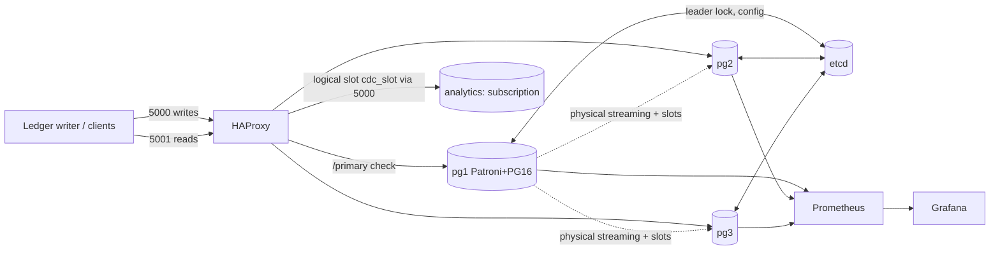

# pg-ha-lab: PostgreSQL high availability and CDC lab

A Dockerized PostgreSQL 16 cluster with automatic failover (Patroni + etcd), a single stable endpoint (HAProxy), logical replication to a separate analytics database, Prometheus/Grafana monitoring, and an automated failover test that proves no acknowledged ledger write is lost.

Workload: a double-entry ledger (every transaction is a balanced debit + credit pair), the kind of data where losing an acknowledged commit is unacceptable.

# Quick start

Requires Docker with Compose v2, Python 3.10+, and make.

```
make up        # builds images, starts everything, waits until the cluster is healthy
make status    # who is leader / sync standby / replica
make test      # kill the primary under load and verify
make switchover   # planned, graceful leader change
make lag       # replication lag as seen by the primary
make clean     # tear down and delete volumes
```

| Endpoint             | URL                                                  |
| -------------------- | ---------------------------------------------------- |
| Primary (read/write) | `localhost:5000` (user `app`, db `ledger`)           |
| Replicas (read-only) | `localhost:5001`                                     |
| Analytics DB         | `localhost:5433` (user `postgres`, db `analytics`)   |
| HAProxy stats        | http://localhost:7000                                |
| Prometheus           | http://localhost:9090                                |
| Grafana              | http://localhost:3000 (dashboard "Postgres HA Lab")  |
| Patroni REST         | `localhost:8008` / `8009` / `8010` (pg1 / pg2 / pg3) |

# Architecture



## Design decisions

| Decision              | Choice                                                                 | Why / trade-off                                                                                                                    |
| --------------------- | ---------------------------------------------------------------------- | ---------------------------------------------------------------------------------------------------------------------------------- |
| Durability            | `synchronous_mode: true`, 1 sync standby                               | Acknowledged commits exist on 2 nodes; Patroni only promotes the sync standby. Cost: commit latency includes a network round trip. |
| Availability fallback | `synchronous_mode_strict: false`                                       | If no standby is available, writes continue asynchronously (availability over durability). Set to `true` to block writes instead.  |
| Failure detection     | TTL 30s, loop 10s                                                      | Faster TTL = faster failover but more false positives under etcd/network jitter.                                                   |
| Routing               | HAProxy HTTP checks on Patroni REST (`/primary`, `/replica`)           | Clients use one stable endpoint; `shutdown-sessions` evicts clients from a demoted primary.                                        |
| Old primary           | `use_pg_rewind` + `wal_log_hints`                                      | Rejoins as a replica without a full re-clone.                                                                                      |
| CDC                   | Logical replication (pgoutput) to a separate analytics Postgres        | Decouples analytics load from the HA cluster.                                                                                      |
| CDC across failover   | Patroni _permanent logical slot_ (`cdc_slot`) + `hot_standby_feedback` | Slot is kept/advanced on replicas so the subscription can resume on the new primary.                                               |
| Disk safety           | `max_slot_wal_keep_size: 2GB`                                          | A dead subscriber cannot fill the primary's disk; the slot is invalidated instead (analytics must resync).                         |
| etcd                  | Single node                                                            | Lab simplification. Production needs 3 (or 5) etcd members, otherwise etcd is the single point of failure.                         |
